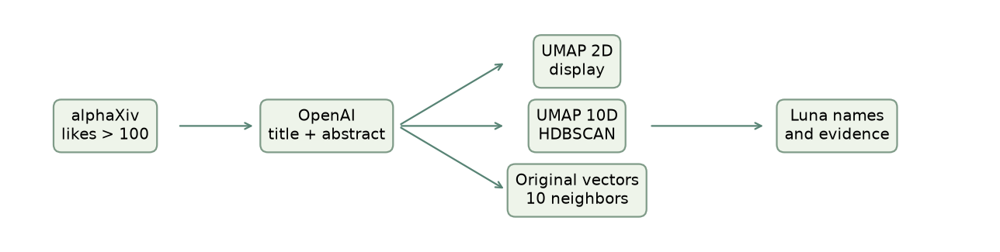

# Paper Atlas

An interactive map of papers with more than 100 public likes on alphaXiv. Every point is a paper. Similar titles and abstracts place papers close together, and selecting a paper reveals its nearest neighbors in the full embedding space. The project includes every subject exposed by the all-time paper feed.

The collection uses the public vote count and verifies the boundary in two independent passes. OpenAI embeds the texts, UMAP constructs the display, HDBSCAN groups papers in a separate ten-dimensional representation, and GPT-6 Luna names each group from representative papers. The research question is how often a paper's ten closest semantic neighbors remain close in two dimensions. [alphaXiv API](https://api-dev.alphaxiv.org/api.json) · [OpenAI embeddings](https://developers.openai.com/api/docs/guides/embeddings) · [UMAP clustering](https://umap-learn.readthedocs.io/en/latest/clustering.html)

**[Open the interactive atlas](https://burnycoder.github.io/top-ai-papers-visualized-alphaxiv/) · [Dataset and frozen vectors](https://huggingface.co/datasets/BurnyCoder/alphaxiv-paper-atlas) · [Research paper](reports/paper.pdf)**

<!-- results:start -->

Collection, projection and evaluation results will appear here after the preregistered run.

<!-- results:end -->

## Study

[Research plan](reports/plan.md) · [Literature review](reports/literature-review.md) · [State of the art](reports/state-of-the-art-review.md) · [Preregistration](reports/preregistration.md) · [Planned runs and controls](reports/planned-runs.md) · [Progress](reports/progress.md)

## Run and explore

Install [uv](https://docs.astral.sh/uv/getting-started/installation/) and run `uv sync --frozen` at the repository root. For a fresh snapshot, copy `.env.example` to `.env`, supply your alphaXiv and OpenAI API keys, and run `uv run atlas refresh`. In another terminal, `uv run atlas monitor` serves the live dashboard at [localhost:8765](http://127.0.0.1:8765/).

For an offline reproduction, download the dated snapshot and run `uv run atlas build --snapshot 2026-11-26`. This regenerates the website, figures, tables and PDF. Run `uv run pytest` for the regression suite. [Exact installation and rebuild commands](docs/reproduce.md) · [Hugging Face collection](https://huggingface.co/collections/BurnyCoder/alphaxiv-paper-atlas-6b0813ca579f3a0893eb123a)

The browser searches titles, authors and paper IDs and filters by subject, cluster, year and likes. A paper can belong to several arXiv subjects. The selectable topic index shows the evidence behind each Luna name. UMAP, scikit-learn, SciPy and NumPy compute the projections and comparisons. The browser uses static HTML, JavaScript and Canvas. Parquet and NumPy carry the downloadable data.

## Future work

- Compare dated snapshots to measure movement across the eligibility boundary.
- Evaluate label usefulness with blinded human judgments.
- Test coverage at other popularity thresholds as separately registered studies.
