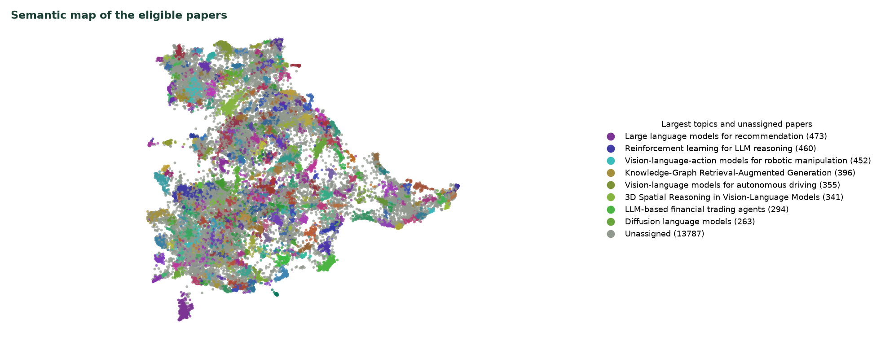
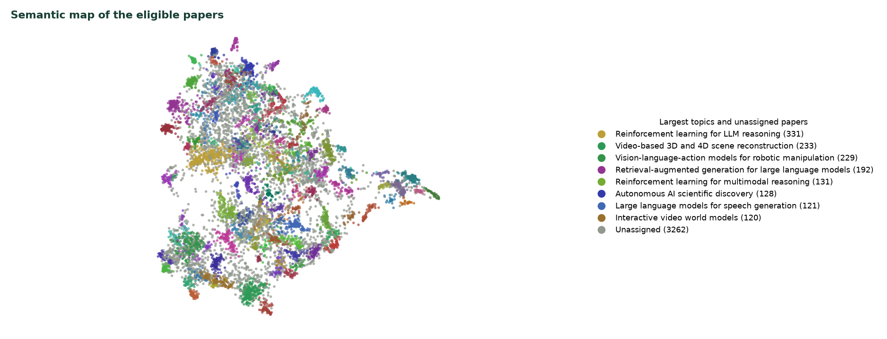
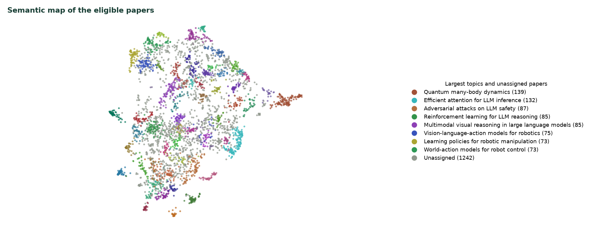

# Paper Atlas

The **more than 10 likes** study uses the all-time alphaXiv feed, OpenAI paper embeddings and separate display and clustering spaces. New hosted calls have a USD 50 ceiling. [Registered protocol](reports/over-10/preregistration.md) · [Run matrix](reports/over-10/planned-runs.md)

<!-- results-over-10:start -->
<!-- results-over-10:end -->

Explore all subjects in the **more than 20 likes** edition. Search by title, author or ID, then select a paper to see its ten closest neighbors in the original embedding space. The edition has a USD 50 API credit ceiling. [Interactive atlas](https://burnycoder.github.io/top-ai-papers-visualized-alphaxiv/over-20/) · [Paper](reports/over-20/paper.pdf) · [Registered protocol](reports/over-20/preregistration.md) · [Collection amendment](reports/over-20/collection-amendment.md) · [Run matrix](reports/over-20/planned-runs.md)

[Watch the map walkthrough](https://burnycoder.github.io/top-ai-papers-visualized-alphaxiv/over-20/walkthrough.mp4)

<!-- results-over-20:start -->

The 2026-11-26 snapshot contains **36,276 unique papers** above 20 likes and **313 named clusters**. The two accepted passes found the same papers. Of 36,329 entries above the threshold, 53 were marked as external posts. The public map shows all 13,787 unassigned papers in gray.

Across 10 seeds, UMAP retained **12.81%** of the original ten nearest neighbors, compared with **0.49%** under PCA. The gain was 12.32 percentage points (95% seed interval 12.27 to 12.37). Even with UMAP, 87.19% of those neighbors fell outside a paper’s ten closest screen points. Select a paper to recover its original-space recommendations. Shuffling the paper-to-position assignment retained 0.03% across the same seeds.

Of these papers, **26,136** had 21–50 likes. The two dated editions share 10,140 paper groups. 26,136 groups appear only in the expanded edition and 0 appear only in the earlier one.

OpenAI usage receipts priced at standard rates total **USD 0.9687** for this edition. The ledger reserved USD 14.4372 against the USD 50.00 ceiling. Attempts without a usage receipt: 0. [Credit ledger](https://github.com/BurnyCoder/top-ai-papers-visualized-alphaxiv/blob/main/results/2026-11-26-over-20/budget.json)

| Display / assignments | Recall at 10 | Clusters | Unassigned | Shared subject within a cluster |
|---|---:|---:|---:|---:|
| UMAP / primary | 12.87% | 313 | 38.01% | 79.95% |
| PCA / primary | 0.49% | 313 | 38.01% | 79.95% |
| Shuffled positions / primary | 0.03% | 313 | 38.01% | 79.95% |
| PCA / PCA-clustering ablation | 0.49% | 21 | 86.65% | 37.19% |

[All seed results and cluster examples](reports/over-20/summary.md) · [Comparison figures](reports/over-20/figures/comparisons.png) · [Seed sensitivity](reports/over-20/figures/metrics.png)

<!-- results-over-20:end -->

Explore the independently fitted editions for **more than 50** and **more than 100** public likes. Both use the same search, clustering and evaluation methods. [Over 50 map](https://burnycoder.github.io/top-ai-papers-visualized-alphaxiv/over-50/) · [Over 100 map](https://burnycoder.github.io/top-ai-papers-visualized-alphaxiv/)

[Expanded research paper](reports/over-50/paper.pdf) · [Expanded dataset](https://huggingface.co/datasets/BurnyCoder/alphaxiv-paper-atlas/tree/atlas-2026-11-26-over-50) · [Preregistration](reports/over-50/preregistration.md) · [Run matrix](reports/over-50/planned-runs.md)

<!-- results-over-50:start -->

The 2026-11-26 snapshot contains **10,140 unique papers** above 50 likes and **115 named clusters**. The two accepted passes found the same papers. Of 10,181 entries above the threshold, 41 were marked as external posts. The public map shows all 3,262 unassigned papers in gray.

Across 10 seeds, UMAP retained **18.69%** of the original ten nearest neighbors, compared with **1.42%** under PCA. The gain was 17.28 percentage points (95% seed interval 17.23 to 17.33). Even with UMAP, 81.31% of those neighbors fell outside a paper’s ten closest screen points. Select a paper to recover its original-space recommendations.

Of these papers, **6,437** had 51–100 likes. The two dated editions share 3,703 paper groups. 6,437 groups appear only in the expanded edition and 0 appear only in the earlier one.

| Display / assignments | Recall at 10 | Clusters | Unassigned | Shared subject within a cluster |
|---|---:|---:|---:|---:|
| UMAP / primary | 18.74% | 115 | 32.17% | 80.13% |
| PCA / primary | 1.42% | 115 | 32.17% | 80.13% |
| Shuffled positions / primary | 0.11% | 115 | 32.17% | 80.13% |
| PCA / PCA-clustering ablation | 1.42% | 17 | 82.79% | 43.02% |

[All seed results and cluster examples](reports/over-50/summary.md) · [Comparison figures](reports/over-50/figures/comparisons.png) · [Seed sensitivity](reports/over-50/figures/metrics.png)

<!-- results-over-50:end -->

## Original edition · more than 100 likes

Every point is a paper. Similar titles and abstracts place papers close together, and selecting a paper reveals its nearest neighbors in the full embedding space. The project includes every subject exposed by the all-time paper feed.

The collection uses the public vote count and verifies the boundary in two independent passes. OpenAI embeds the texts, UMAP constructs the display, HDBSCAN groups papers in a separate ten-dimensional representation, and GPT-6 Luna names each group from representative papers. The research question is how often a paper's ten closest semantic neighbors remain close in two dimensions. [alphaXiv API](https://api-dev.alphaxiv.org/api.json) · [OpenAI embeddings](https://developers.openai.com/api/docs/guides/embeddings) · [UMAP clustering](https://umap-learn.readthedocs.io/en/latest/clustering.html)

**[Open the interactive atlas](https://burnycoder.github.io/top-ai-papers-visualized-alphaxiv/) · [Dataset and frozen vectors](https://huggingface.co/datasets/BurnyCoder/alphaxiv-paper-atlas) · [Research paper](reports/paper.pdf)**

<!-- results:start -->

The 2026-11-26 snapshot contains **3,703 unique papers** and **56 named topics**. Both passes found the same papers. Of 3,723 entries above the threshold, 20 were marked as external posts. The public map shows all 1,242 unassigned papers in gray.

Across 10 seeds, UMAP retained **26.34%** of the original ten nearest neighbors, compared with **2.86%** under PCA. The gain was 23.49 percentage points (95% seed interval 23.36 to 23.61). Even with UMAP, 73.66% of those neighbors fell outside a paper’s ten closest screen points. Select a paper to recover its original-space recommendations.

| Display / assignments | Recall at 10 | Clusters | Unassigned | Shared subject within a cluster |
|---|---:|---:|---:|---:|
| UMAP / primary | 26.29% | 56 | 33.54% | 70.36% |
| PCA / primary | 2.86% | 56 | 33.54% | 70.36% |
| Shuffled positions / primary | 0.24% | 56 | 33.54% | 70.36% |
| PCA / PCA-clustering ablation | 2.86% | 10 | 75.21% | 68.66% |

[All seed results and cluster examples](reports/summary.md) · [Comparison figures](reports/figures/comparisons.png) · [Seed sensitivity](reports/figures/metrics.png)

<!-- results:end -->

## Study

[Research plan](reports/plan.md) · [Literature review](reports/literature-review.md) · [State of the art](reports/state-of-the-art-review.md) · [Preregistration](reports/preregistration.md) · [Planned runs and controls](reports/planned-runs.md) · [Progress](reports/progress.md)

## Run and explore

Install [uv](https://docs.astral.sh/uv/getting-started/installation/) and run `uv sync --frozen` at the repository root. For a fresh snapshot, copy `.env.example` to `.env`, set your OpenAI key, and run `uv run atlas refresh`. New snapshots default to more than 20 likes, anonymous alphaXiv metadata and a USD 50 ceiling. For an older cutoff, pass `--threshold 50` or `--threshold 100` and supply the alphaXiv key. In another terminal, `uv run atlas monitor --port 0` prints the URL of the live dashboard.

For an offline reproduction, download the dated snapshot and run `uv run atlas build --snapshot 2026-11-26`. This regenerates the website, figures, tables and PDF. Run `uv run pytest` for the regression suite. [Exact installation and rebuild commands](docs/reproduce.md) · [Hugging Face collection](https://huggingface.co/collections/BurnyCoder/alphaxiv-paper-atlas-6b0813ca579f3a0893eb123a)

The browser searches titles, authors and paper IDs and filters by subject, cluster, year and likes. A paper can belong to several arXiv subjects. The selectable topic index shows the evidence behind each Luna name. UMAP, scikit-learn, SciPy and NumPy compute the projections and comparisons. The browser uses static HTML, JavaScript and Canvas. Parquet and NumPy carry the downloadable data.

## Future work

- Compare dated snapshots to measure movement across the eligibility boundary.
- Evaluate label usefulness with blinded human judgments.
- Test coverage at other popularity thresholds as separately registered studies.
