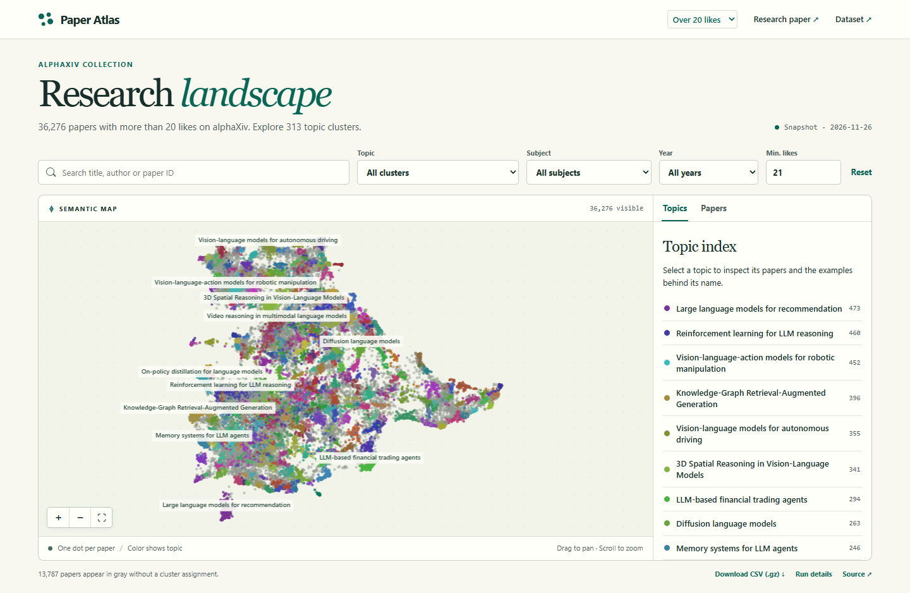
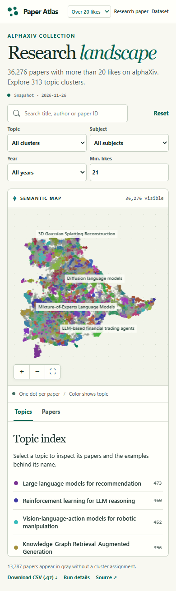

# Browser and paper review · 26 November 2026

The full over-20 map passed the real Chrome interaction checks. Desktop checks exercised title, author and paper-ID search, a point selection, the fetched abstract, all recommended neighbors, a shareable paper link, combined filters, topic evidence, the empty-result state, zoom, reset and the CSV download. Switching to both earlier editions and back loaded each edition’s own minimum-like filter. Mobile checks exercised search and paper selection and confirmed that the page fits the viewport. [Browser test](../../../tests/browser_smoke.py) · [Walkthrough](../../../docs/over-20/walkthrough.mp4)

The rendered PDF was inspected page by page. The title page includes the requested author and date, the methods page shows the data flow, and the final pages contain the evaluation, limitations and AI statement. [Research paper](../paper.pdf) · [Independent numerical review](release.md)
